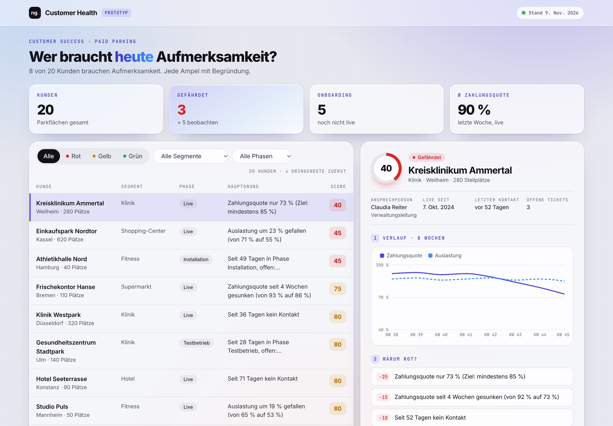

# Customer Health Dashboard · Prototyp

Ein kleines, funktionierendes Dashboard für Customer Success im Bereich Paid Parking: Welche Parkflächen-Kunden brauchen gerade Aufmerksamkeit, warum, und was ist der nächste Schritt?

**Live-Demo:** _wird nach dem Deployment ergänzt_

> Prototyp von Noel Gruber · Beispieldaten · nicht mit Wemolo verbunden.
> Alle Kunden, Namen und Zahlen sind erfunden.



## Was ist das?

Ein Dashboard für 20 erfundene Parkflächen-Kunden (Supermärkte, Kliniken, Hotels, Fitnessstudios, Shopping-Center), deren Parkplätze ohne Schranke und Ticket laufen: Kameras erkennen Kennzeichen, Parkende zahlen online oder am Automaten.

* **Übersicht:** 4 Kennzahlen und eine Liste mit Ampel, sortiert nach Dringlichkeit, filterbar nach Ampel, Segment und Onboarding-Phase.
* **Nachvollziehbarer Health Score:** Jede Ampel hat eine Begründung in einem Satz, z. B. „Zahlungsquote seit 4 Wochen gesunken (von 92 % auf 73 %)“.
* **Onboarding und Readiness:** Vertrag → Installation → Testbetrieb → Live, mit Checkliste und Hinweis, wenn ein Go-live überfällig ist.
* **Detailansicht:** 8-Wochen-Verlauf von Zahlungsquote und Auslastung, Begründungen, empfohlener nächster Schritt, letzte Notiz. Jeder Kunde hat einen eigenen Link (`#/kunde/c07`).
* **Bericht & Mail-Entwurf:** Für gelbe und rote Kunden ein kurzer Monatsbericht mit Empfehlungen und ein Mail-Entwurf an die Ansprechperson.
* Funktioniert auf Desktop, Tablet und Handy.

## Warum gebaut?

Als Ergänzung zu meiner Bewerbung als Customer Success Manager. Ich wollte zeigen, wie ich an Customer Health herangehe: früh erkennen, die Ursache verstehen, konkret handeln. Und dass ich so ein Werkzeug nicht nur beschreiben, sondern auch bauen kann.

## Wie der Health Score funktioniert

Keine Blackbox, sondern sechs einfache Regeln, die man im Kopf nachrechnen kann. Jeder Kunde startet mit **100 Punkten**, jede Regel, die anschlägt, zieht Punkte ab und liefert einen Satz als Begründung.

| Regel | Wann? | Abzug |
|---|---|---|
| R1 Zahlungsquote niedrig | letzte Woche unter 85 % (unter 75 %: stärker) | −15 / −25 |
| R2 Zahlungsquote fällt | mind. 5 Prozentpunkte unter dem Schnitt der Wochen 1 bis 4 | −15 |
| R3 Auslastung fällt | letzte 2 Wochen mind. 15 % unter dem Schnitt der Wochen 1 bis 4 | −20 |
| R4 Lange kein Kontakt | über 30 Tage (über 60: stärker) | −10 / −20 |
| R5 Viele offene Tickets | ab 3 (ab 6: stärker) | −10 / −20 |
| R6 Onboarding hängt | über 21 Tage in derselben Phase (über 45: stärker) | −20 / −35 |

* **Ampel:** 85 bis 100 grün, 50 bis 84 gelb, unter 50 rot. Ein kleines Signal allein lässt einen Kunden grün, ein starkes oder zwei kleine machen ihn gelb, rot wird er erst bei mehreren Problemen gleichzeitig.
* **Sortierung:** niedrigster Score zuerst, bei Gleichstand der größere Kunde.
* **Nächster Schritt:** Die Regel mit dem größten Abzug bestimmt die Empfehlung (z. B. Zahlungsquote → Vor-Ort-Check von Schildern und Automat).
* Gewichte und Schwellen stehen an einer Stelle in [`src/lib/health.ts`](src/lib/health.ts) und sind mit Tests abgesichert. Ausführlich begründet in [`docs/PLAN.md`](docs/PLAN.md).

## Bericht & Mail-Entwurf

Die Texte für die 8 gelben und roten Kunden wurden **einmalig beim Bauen mit Claude erzeugt** und von Hand geprüft ([`data/ai-texts.json`](data/ai-texts.json)). Der Button zeigt sie mit einer kurzen Ladeanimation an. Es gibt keinen API-Aufruf, keine Kosten und keinen Schlüssel im Projekt. Ein automatischer Test prüft jeden Text: richtige Anrede (Du oder Sie), Länge, keine Gedankenstriche, keine Floskeln.

### So könnte man es live anbinden (nur beschrieben, nicht gebaut)

1. Ein kleiner Server-Endpunkt (z. B. eine Vercel Function) nimmt die Kundendaten und den Health Score entgegen und ruft die **Claude API** auf. Der API-Schlüssel liegt nur auf dem Server, nie im Browser.
2. Der Prompt enthält die gleichen Vorgaben wie hier: Zahlen aus dem Dashboard, letzte Notiz, Du/Sie aus den Kontaktdaten, 3 bis 5 Sätze, konkreter Vorschlag mit Termin, keine Floskeln.
3. Ein **Tageslimit** (z. B. 50 Aufrufe pro Tag) begrenzt die Kosten. Gleiche Anfragen werden für einen Tag zwischengespeichert.
4. **Fallback:** Ist das Limit erreicht oder die API nicht erreichbar, zeigt der Button die vorab erzeugten Texte.
5. Die Mail geht nie automatisch raus. Sie landet immer als Entwurf bei der zuständigen Person, die sie prüft und selbst verschickt.

## Technik

Vite · React · TypeScript · Tailwind CSS · Recharts · Vitest. Kein Backend, keine Datenbank, keine Secrets: Die Daten liegen als JSON im Projekt, die Seite ist statisch auf Vercel gehostet.

```bash
npm install
npm run dev      # lokal starten: http://localhost:5173
npm test         # 42 Tests
npm run build    # fertige Seite nach dist/
```

```
data/            Beispieldaten und vorab erzeugte Texte
docs/            Plan, Lernnotizen, Video-Skript, Screenshot
design/mockups/  Design-Entwürfe (A, B, C und die gewählte Mischung D)
src/lib/         Logik: Health Score, Filter, Kennzahlen (getestet)
src/components/  Oberfläche
```

## Wie es entstanden ist

In sechs Phasen mit Claude Code, nach jeder Phase angehalten und geprüft: Planung → Beispieldaten → Health Score mit Tests → Design-Mockups und Oberfläche → Bericht und Mail → Veröffentlichung. Die Notizen dazu stehen in [`docs/LEARNING.md`](docs/LEARNING.md).
